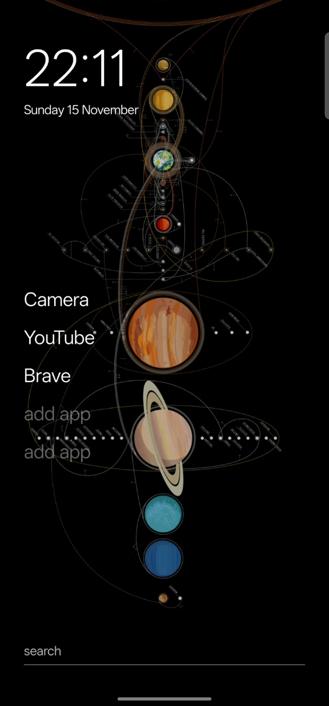
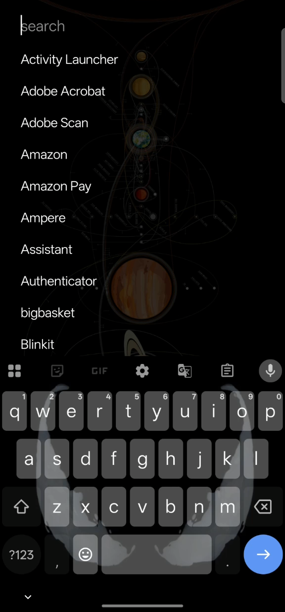
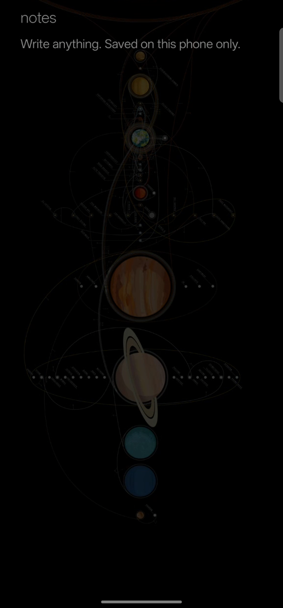
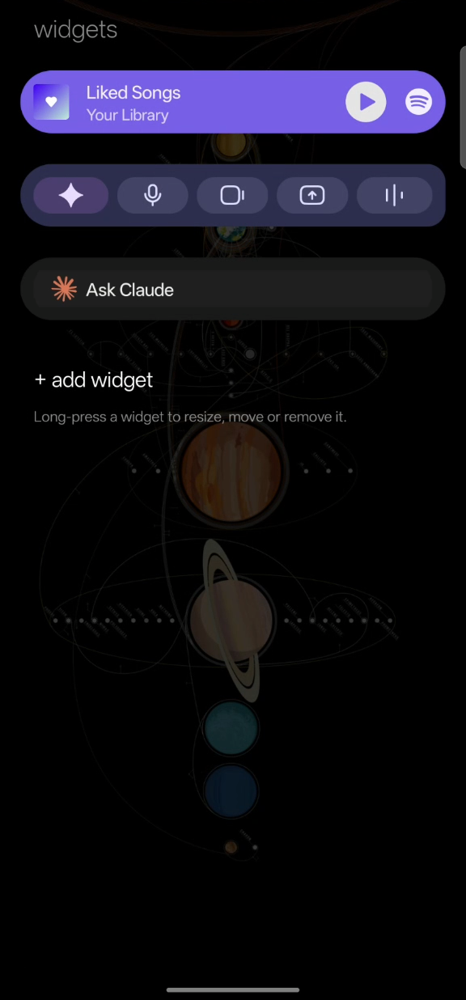

# Minimal Launcher

A text-only Android home screen for entry-level phones (2–3 GB RAM, Android 8.1+).
No icons, no dock. Optional widgets live on their own page and cost nothing while it's closed. Any static or live wallpaper shows through at zero cost.
Release APK is ~175 KB.

| Home | App drawer | Notes | Widgets |
|---|---|---|---|
|  |  |  |  |

**[Watch the 45-second demo video](demo/demo.mp4)**

## Features

- **Text only.** Home shows a clock and a few app names you choose. Everything else is one swipe away in a searchable drawer.
- **Fast search.** Type a few letters; when one app is left, it launches.
- **Notes page.** Swipe right for a plain scratchpad, saved on the phone only.
- **Widgets page.** Swipe left. Widgets use memory only while the page is open.
- **Adjustable.** Number of apps on home, alignment, text size, light or dark text, and each page can be turned off.
- **Hide and rename apps**, with work-profile apps listed alongside personal ones.
- **Private.** No INTERNET permission, no analytics, no ads.
- **Small.** One dependency (`androidx.recyclerview`), and a target of 30–40 MB of RAM while idle on home.

## Download

**[Download the latest APK](https://github.com/CurlyRishabh/minimal-launcher/releases/latest/download/minimal-launcher.apk)** (about 175 KB), or see [all releases](https://github.com/CurlyRishabh/minimal-launcher/releases).

Open the file on your phone and allow your browser or file manager to install apps when Android asks. Then [set it as the default home app](#4-set-it-as-the-default-home-app).

**Contents:** [Download](#download) · [Gestures](#gestures) · [Project layout](#project-layout) · [Build](#1-build-in-android-studio) · [Install](#3-install) · [Set as default](#4-set-it-as-the-default-home-app) · [Revert](#5-if-something-breaks-how-to-revert) · [Known limitations](#known-limitations) · [Verify performance](#verify-performance)

## Gestures

| Gesture / action | Result |
|---|---|
| Tap an app name | Launch |
| Long-press an app name on home | Reassign / remove |
| Tap or long-press "add app" | Pick an app for that slot |
| Swipe up | App drawer (keyboard opens unless turned off in Settings) |
| Tap "search" at the bottom of home | App drawer with keyboard |
| Swipe right (start mid-screen) | Notes page; swipe left / Back / Home to close |
| Swipe left | Widgets page; swipe right / Back / Home to close |
| On the widgets page | "+ add widget" (text picker: app → widget). Long-press a widget: taller / shorter / move / remove |
| Swipe down | Notification shade |
| Double-tap empty space | Lock screen (opt-in, Android 9+) |
| Long-press empty space | Settings |
| Tap the clock | Alarms |
| In the drawer, "Search files…" | Opens Android's file picker (has its own 🔍); the chosen file opens in its app |
| In the drawer | One match left → it launches. Start with a space to turn that off for one search. Long-press an app for add to home / rename / hide / app info / uninstall. Swipe down at the top of the list or press Back to close. |

## Project layout

```
app/src/main/
├── AndroidManifest.xml          HOME/DEFAULT/LAUNCHER filter, <queries>, accessibility service
├── java/com/minimal/launcher/
│   ├── MainActivity.kt          Home, drawer, gestures, clock, onTrimMemory
│   ├── SettingsActivity.kt      Settings list + accessibility explanation dialog
│   ├── AppRepository.kt         LauncherApps + file cache + change tracking (background thread)
│   ├── AppFilter.kt             Allocation-free search ranking
│   ├── AppAdapter.kt            RecyclerView adapter (text rows)
│   ├── AppEntry.kt, Prefs.kt    Model + SharedPreferences
│   ├── NoteStore.kt             Notes page storage (private file, background I/O)
│   ├── WidgetsPage.kt           Widgets page: add/bind/configure flow, resize/move/remove
│   ├── WidgetHost.kt            AppWidgetHost + host view with reliable long-press
│   ├── LockService.kt           AccessibilityService: lock screen / open shade
│   └── Ui.kt                    Edge-to-edge + system bar icon colour
└── res/                         Layouts, theme (windowShowWallpaper), strings, a11y config
```

Its only dependency is `androidx.recyclerview` (it brings in `androidx.core`). The app uses no AppCompat, no Compose, no INTERNET permission and no analytics.

---

## 1. Build in Android Studio

1. Install the latest **Android Studio**. It bundles JDK 17+ and the SDK manager.
2. Choose **File → Open** and select this folder (the one containing `settings.gradle.kts`). Wait for the Gradle sync to finish.
   If Studio offers to install SDK Platform 36 or to upgrade the Android Gradle Plugin, accept. To target a newer stable API, raise `compileSdk`/`targetSdk` in `app/build.gradle.kts`.
3. To build:
   - Debug: **Build → Build App Bundle(s)/APK(s) → Build APK(s)**, or run `./gradlew assembleDebug`.
   - Release (R8 + resource shrinking): `./gradlew assembleRelease`. It's signed with the debug key so you can install it directly. Use your own keystore if you distribute it.
   - Outputs: `app/build/outputs/apk/debug/app-debug.apk` and `app/build/outputs/apk/release/app-release.apk`.

Use the **release** build day-to-day. Debug builds are unoptimised and use noticeably more RAM.

## 2. Enable Developer options and debugging on the phone

1. **Settings → About phone** → tap **Build number** 7 times. On Xiaomi it's "MIUI/OS version"; on Samsung, look under *Software information*.
2. **Settings → System → Developer options**:
   - **USB debugging**: turn on, plug the phone in, and accept the "Allow USB debugging?" prompt.
   - **Wireless debugging** (Android 11+): turn on, tap **Pair device with pairing code**, then on your computer:
     ```
     adb pair <ip>:<pairing-port>     # enter the 6-digit code
     adb connect <ip>:<port>          # port shown on the Wireless debugging screen
     ```
   Android Studio also has **Device Manager → Pair devices using Wi-Fi**.
3. Check that the phone is visible: `adb devices`.

## 3. Install

- From Android Studio: pick the device in the toolbar and press **Run ▶**. Use **Build Variants → release** to run the optimised build.
- From the command line:
  ```
  ./gradlew installRelease
  # or
  adb install -r app/build/outputs/apk/release/app-release.apk
  ```

## 4. Set it as the default home app

Press the Home button. Android asks which home app to use: pick **Minimal Launcher → Always**.
Or do it from Settings:

- **Settings → Apps → Default apps → Home app → Minimal Launcher**
  (Samsung: *Settings → Apps → Choose default apps → Home app*.)
- Or long-press empty space on the home screen → **Set as default launcher**.

Optional: to enable **double-tap to lock**, open Settings → *Double-tap to lock*, read the explanation, and turn on **Minimal Launcher lock** in Accessibility settings.
If Android shows *"Restricted setting"* (Android 13+, mostly for APKs installed from a browser or file manager), go to App info → ⋮ → **Allow restricted settings**, then try again. APKs installed with `adb` are not restricted.

## 5. If something breaks: how to revert

Any of these works:

1. **Settings → Apps → Default apps → Home app** → choose your old launcher (Pixel Launcher, One UI Home, System launcher, …).
2. If you can't reach Settings from the launcher: pull down the notification shade → ⚙ gear icon → step 1.
3. Over adb:
   ```
   adb uninstall com.minimal.launcher
   ```
   Android falls back to the stock launcher immediately.
4. Last resort: boot into **Safe mode** (on most phones, hold the *Power off* option). Third-party apps are disabled there, so the stock launcher runs and you can change the default or uninstall.

## Known limitations

- **Swipe down → notifications.** There is no public API for this. The launcher tries these in order:
  1. The accessibility service, if enabled. This always works.
  2. The hidden `StatusBarManager.expandNotificationsPanel()` via reflection, using the `EXPAND_STATUS_BAR` permission. This works on most phones, but some vendors block it.
  3. A hint to swipe from the top edge.
- **Double-tap lock** requires Android 9+ (`GLOBAL_ACTION_LOCK_SCREEN`) and the accessibility service. Unlike device-admin locking, fingerprint/face unlock keeps working.
- **File search** goes through Android's file picker. Since Android 11, reading your documents directly would need "All files access", which a launcher shouldn't have. The picker can't be pre-filled with what you typed, so tap its 🔍 and type again.
- **Widgets** use memory only while the widgets page is on screen:
  - Updates are paused when you leave the page.
  - All widget views are released when you close it, and rebuilt from Android's cache when you reopen it. That can take a moment with many widgets.
  - The first widget from each app asks *"Allow Minimal Launcher to create widgets…?"*. That's Android's standard prompt; tap **Allow**.
  - Widgets with their own scrolling list (inbox, calendar agenda) may not scroll inside the page. The page itself scrolls instead.
- **Swipe right for notes** must start away from the left edge. With gesture navigation, a swipe from the very edge is Android's Back gesture.
- **New work-profile setups** may need **Settings → Refresh app list** once.

---

## Verify performance

Always measure the **release** build: `./gradlew installRelease`.

### Idle RAM: `dumpsys meminfo`

```
adb shell input keyevent KEYCODE_HOME     # make sure the launcher is in front
adb shell dumpsys meminfo com.minimal.launcher
```

Read **TOTAL PSS** (or **TOTAL** in the App Summary) at the top of the output. That's the real memory cost, including shared pages. A useful breakdown:
- *Java Heap*: our objects.
- *Native Heap*: mostly text rendering.
- *Graphics*: GPU buffers for the window.

The target is ~30–40 MB PSS while idle on home (widgets page closed). With the widgets page open, expect more: each widget adds its own views and images. Close the page and wait a few seconds, and the number should drop back. Compare against another launcher by running the same command with its package name (e.g. `fr.neamar.kiss`).

To see memory being released after leaving the launcher:
```
adb shell am send-trim-memory com.minimal.launcher RUNNING_LOW      # while visible
adb shell am send-trim-memory com.minimal.launcher HIDDEN            # drops drawer data
adb shell am send-trim-memory com.minimal.launcher BACKGROUND        # also drops app list
adb shell dumpsys meminfo com.minimal.launcher
```

### Idle RAM: Android Studio Memory Profiler

1. **Run → Profile 'app'** (or **View → Tool Windows → Profiler**). Choose the device and the `com.minimal.launcher` process. Use **Profileable (low overhead)** mode with the release build.
2. Go to home, wait ~10 s for the app list to load, and leave the phone idle.
3. Read **Total** in the memory timeline. Click **Force GC** (🗑) first so garbage doesn't inflate the number.
4. Open and close the drawer a few times, then force GC. The memory should drop back to the same baseline; a steady climb means a leak.

### Cold start: `am start -W`

```
adb shell am force-stop com.minimal.launcher
adb shell am start -W -n com.minimal.launcher/.MainActivity
```

Read **TotalTime** (ms). It's the time from process start to the first frame. Run it 5–10 times and take the median.
For a warm start, skip the `force-stop`.
Compare against your current launcher's numbers, measured the same way.

Things that keep startup fast:
- The first frame draws only the clock and the favorites, read from SharedPreferences.
- The app list loads from a small file cache on a background thread.
- The drawer (RecyclerView) is inflated only once the UI thread goes idle.
